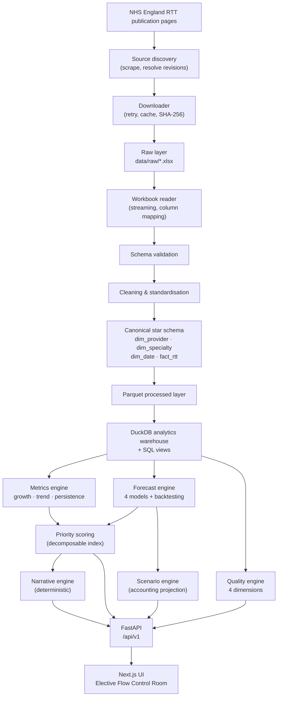

# NHS Elective Flow Intelligence

**Operational decision intelligence for NHS elective waiting list management using public NHS England data.**

The system converts public elective care data into operational signals by combining
longitudinal performance analysis, transparent priority scoring, short-horizon
forecasting and capacity scenario modelling.

> **Independent portfolio prototype.** Not affiliated with, endorsed by, or connected to
> NHS England or any NHS organisation. Not a clinical decision support, triage or
> diagnosis system. Uses only aggregate, published, non-patient-identifiable statistics.

## Demo and deployment status

The repository records a frontend deployment on 19 August 2026. That deployment
commit explicitly states that the backend was not yet hosted. The Render blueprint
and configured API URL are deployment preparation, not evidence of a running API.
Current end-to-end availability has not been verified for this revision.

| Component | URL | Evidence status |
|---|---|---|
| Frontend | https://nhs-elective-flow-intelligence.vercel.app | Deployment recorded; current availability unverified |
| API docs (configured destination) | https://nhs-elective-flow-api.onrender.com/docs | Backend deployment unverified |
| API health (configured destination) | https://nhs-elective-flow-api.onrender.com/health | Check before presenting a working full-stack demo |

The frontend retries GET requests and displays unavailable-data states. Those
behaviours also apply when a backend is absent; a loading or retry state does not
prove that a sleeping service will eventually respond.

---

## The problem

NHS organisations manage large elective waiting lists across many specialties under
finite operational capacity. Existing dashboards report the position well: list size,
waiting-time distributions, activity, historical trend.

But reporting a metric does not answer the question a Head of Performance actually has
on a Monday morning:

> **Where should we investigate first — and why?**

Across 155 providers and 23 treatment functions there are over three thousand
provider × specialty services. Every one of them has a waiting list, a growth rate, an
18-week position and a long-wait tail. A ranked list of "biggest waiting lists" points
you at the largest organisations, not the ones deteriorating fastest. A ranked list of
"worst 18-week performance" points you at services that have been structurally
challenged for years. Neither tells you where attention will change the trajectory.

## The product

**Elective Flow Control Room** — a decision-support layer over published NHS England
Referral to Treatment (RTT) statistics. It ingests the official monthly provider-level
workbooks, builds a reproducible analytical warehouse, and produces:

| Layer | Question answered |
|---|---|
| **Descriptive** | What is the current position, and how has it moved? |
| **Diagnostic** | Is backlog outpacing activity? Is deterioration persistent or a one-month anomaly? |
| **Predictive** | If recent behaviour continues, where does this land in 3–6 months? |
| **Prescriptive** | What would an activity uplift change — and what uplift stabilises the list? |
| **Governance** | Is the underlying data complete, fresh, consistent and free of unexplained jumps? |

### Why this is more than a dashboard

- **Transparent priority scoring** — a 0–100 operational priority index over every
  provider × specialty, fully decomposable into five weighted components. Every score
  can answer *"why this score?"* with the actual numbers behind it. No black box.
- **Honest short-horizon forecasting** — four interpretable models compete on
  rolling-origin out-of-sample error. The winner is refit and reported with a
  confidence label derived from backtest accuracy, not in-sample fit. On the reference build, the naive-drift candidate is selected **43% of the time**, and that is published rather than
  hidden.
- **Illustrative capacity scenarios** — an accounting projection that tests what a 5 /
  10 / 15 / 20% activity uplift would do to the modelled backlog, plus the uplift
  implied to stabilise it. Labelled as a modelled estimate with its assumptions
  attached, never as a causal claim.
- **A real data quality engine** — completeness, consistency, freshness and anomaly
  detection over ~73,000 fact rows, with every finding listed and a documented
  composite score.
- **Deterministic management briefings** — executive prose assembled from computed
  values by a rules engine. If a metric is missing the sentence is omitted, so the
  narrative can never assert something the data does not support.
- **Provenance throughout** — source URL, SHA-256 checksum, publication date and row
  count recorded for every ingested file and surfaced in the interface.

---

## Key features

> Screenshots are not committed, because they would pin a specific data vintage and go
> stale with each monthly publication. `make demo && make dev` gives you the full
> interface in about a minute — see
> [docs/screenshots](docs/screenshots/README.md) for a capture guide.

### Elective Flow Control Room
Executive KPI row (each with its definition, source and calculation attached), a
priority matrix plotting growth against long-wait burden, an auto-generated
"what needs attention" list, and a sortable ranked table with CSV export.

### Service detail
For any provider × specialty: performance overview, waiting-list history with the
forecast overlaid and its prediction interval, wait-band composition, activity trend,
a full priority-score decomposition, an interactive scenario simulator, peer
benchmarking, service-level data quality, and a generated executive brief.

### Provider comparison
Benchmark up to five providers within one treatment function against the specialty
peer median.

### Data quality monitor
Dimension scores, supporting measurements and a filterable issue register.

### How it works
The complete methodology, in-app: every formula, every threshold, every limitation.

---

## Architecture



Expensive work (forecasting every series, quality checks over 73k rows) happens **once
at build time**. The API only reads precomputed tables, so the dashboard is fast.

See [docs/architecture.md](docs/architecture.md) for component detail and design
rationale.

---

## Data

| | |
|---|---|
| **Source** | NHS England — Consultant-led Referral to Treatment (RTT) Waiting Times |
| **Basis** | Provider level (the product compares provider organisations) |
| **Grain** | One row per provider × treatment function × reporting month |
| **Period loaded** | 21 months (October 2024 – June 2026 in the reference build) |
| **Scale** | 155 providers · 23 treatment functions · 72,956 fact rows |
| **Licence** | Open Government Licence v3.0 |
| **PII** | None. Aggregate published statistics only. |

The repository includes a processed aggregate snapshot in `data/processed/`:
dimension and RTT tables, plus application-derived metrics, forecasts, priority
scores, quality results, ingestion audit and metadata. Raw source workbooks are
excluded. The separately labelled `data/sample/` files are synthetic examples.
`scripts/materialise_warehouse.py` rebuilds DuckDB from the committed Parquet
files without downloading the source workbooks.

The source-code licence does not grant rights to third-party data. The existing
data attribution is retained; source terms, attribution completeness and
redistribution rights still require review before further data reuse or release.

Three workbooks are ingested per reporting month: **incomplete pathways** (the waiting
list), **completed admitted pathways** and **completed non-admitted pathways**.

### Robust ingestion

NHS England filenames carry random suffixes and `-revised` markers, and the publication
pages are reorganised between financial years. Filenames therefore cannot be
constructed — they are **discovered**:

1. Fetch the publication pages listed in [`config/sources.yaml`](config/sources.yaml)
2. Match candidate files against configured filename patterns
3. Parse the reporting month, resolve revisions (highest revision wins)
4. Download with retry and checksum
5. Validate the schema, adapting if the header row has moved
6. Map published captions to canonical names in one place

If discovery fails, a deterministic fallback exists:

```bash
python scripts/download_data.py --url "https://www.england.nhs.uk/.../Incomplete-Provider-Mar26-....xlsx" --dataset incomplete
```

Every dataset carries `data_source_type` — `OFFICIAL_NHS_PUBLIC` or `DEMO_SYNTHETIC` —
displayed in the header, footer and every CSV export. Demo mode shows a persistent
banner and uses fictional provider names, so a synthetic figure can never be mistaken
for a real organisation's published position.

---

## Analytics

Derived within each provider × specialty series, ordered by month:

```
backlog_growth_3m_pct  = (list_t − list_{t−3}) / list_{t−3} × 100
pct_within_18_weeks    = within_18_weeks / total_incomplete × 100
trend_slope_6m         = OLS slope over the last 6 monthly values
months_to_clear        = list_t / mean(completed activity, 3 months)
implied_additions      = backlog_change_1m + completed_pathways
```

Division is NaN-safe throughout. A specialty appearing for the first time has no valid
growth rate; returning null keeps it excludable rather than letting an infinity poison
every downstream percentile.

`implied_additions` is an **accounting identity, not observed referrals** — NHS England
does not publish referrals at this grain, so the word "demand" is deliberately avoided.

Full definitions: [docs/data_dictionary.md](docs/data_dictionary.md) ·
[docs/methodology.md](docs/methodology.md)

---

## Priority score

```
Priority Score (0–100) =
    30%  Backlog growth pressure     3-month growth + 6-month trend slope
  + 25%  Long-wait burden            share beyond 52 / 65 / 78 weeks
  + 20%  18-week performance gap     shortfall vs 92% benchmark + direction
  + 15%  Forecast deterioration risk modelled 3-month change
  + 10%  Trend persistence           consistency of deterioration

Bands:  0–24 LOW · 25–49 MODERATE · 50–74 HIGH · 75–100 CRITICAL
```

Design decisions worth defending in an interview:

- Components are normalised **cross-sectionally within the latest reporting month**, so
  the score expresses *relative position among peers*, not absolute severity.
- **Percentile rank** where only ordering is meaningful; **clipped robust scaling**
  (5th–95th percentile) where magnitude carries information. Min-max is deliberately
  avoided — one extreme provider would compress everyone else into the bottom of the
  range.
- Components that cannot be computed score a **neutral 50**, not zero, so a missing
  forecast neither rewards nor punishes a service.
- Services below 200 pathways are **excluded from the scoring basis and reported as
  `UNSCORED`**, with their raw metrics shown in full. A 40-pathway list can post 50%
  growth from noise; and since every component would fall back to the neutral 50, such
  services would otherwise all total exactly 50 and appear as uniformly "HIGH" — an
  artefact of the defaults, not a finding.
- Every component's contribution is stored alongside the total. `contributions.sum() ==
  priority_score` is enforced by test.

### Score decomposition, as shown in the product

```
Backlog growth pressure      86 / 100  →  25.9 / 30
Long-wait burden             89 / 100  →  22.3 / 25
18-week performance gap      94 / 100  →  18.7 / 20
Forecast deterioration risk  84 / 100  →  12.6 / 15
Trend persistence            90 / 100  →   9.0 / 10
                                          ──────────
Total                                      88.5 / 100  — CRITICAL
```

---

## Forecasting

Waiting-list forecasts at **+1, +3 and +6 months**, per provider × specialty.

| | |
|---|---|
| **Candidates** | Naive drift · Linear trend (full and 6-month) · Holt linear · Damped trend |
| **Selection** | Lowest one-step MAE under expanding-window rolling-origin backtesting |
| **Intervals** | `point ± 1.28 × σ × √h` — indicative 80% band |
| **Insufficient history** | Returns `insufficient_history`, never a fabricated number |
| **Confidence** | From backtest MAPE: High ≤ 3%, Moderate ≤ 8%, otherwise Low |

Models are deliberately interpretable. With 12–24 monthly observations per series,
anything elaborate would overfit, and the audience needs to be able to challenge the
method in an operational meeting.

**Observed performance on the reference build** (June 2026 data, 2,078 forecastable series):

| Metric | Value |
|---|---|
| Median backtest MAPE | **3.68%** |
| Series beating the naive benchmark | **54.8%** |
| Series with insufficient history | 1,487 (reported, not forecast) |
| Confidence: High / Moderate / Low | 779 / 1,029 / 270 |
| Most-selected model | `naive_drift` (901 series, 43%) |

That the naive-drift candidate is selected 43% of the time is a finding about this reference build, and it is surfaced in the product rather than buried.

---

## Scenario analysis

An accounting projection, not causal inference:

```
additional_activity  = uplift% / 100 × mean(completed pathways, 3 months)
scenario_backlog(h)  = max(0, baseline_forecast(h) − h × additional_activity)

uplift_to_stabilise  = (forecast_3m − current) / (3 × mean_activity) × 100
```

Enforced invariants (all covered by tests):

- 0% uplift reproduces the baseline **exactly**
- Higher uplift **never** increases the modelled backlog at any horizon
- Scenario backlog is **floored at zero**
- Effect accumulates with horizon

Stated assumptions travel with every result: referral behaviour, case mix, clinical
urgency and validation practice are assumed unchanged; workforce, theatre, estate and
diagnostic constraints are not represented; the model does not assess whether an uplift
is *achievable*.

---

## Data quality

```
Quality Score (0–100) =
    40%  Completeness    populated key measures (60%) + panel rectangularity (40%)
  + 25%  Consistency     duplicates · negatives · part>whole · band nesting ·
                         out-of-range percentages · reconciliation vs published
  + 20%  Freshness       full marks to a 2-month publication lag, −15/month after
  + 15%  Anomaly burden  inverse of the flagged month-on-month anomaly rate
```

Anomalies are month-on-month movements beyond **3.5 robust standard deviations**
(median/MAD) with an absolute change of at least 50 pathways, so small lists do not
generate noise.

Findings are described as **items requiring review**, never as errors in the published
data. Public statistics contain legitimate reporting changes, organisational mergers
and genuine step-changes that an automated check cannot distinguish from a data
problem.

**Reference build: 94.9 / 100**, with 1,104 findings — 1,081 unusual month-on-month
movements and 23 missing reporting months.

One consistency check is worth calling out: percentages are **recomputed from counts**
rather than inherited from the publication, then **reconciled against the published
values**. That catches derivation drift on our side, not just problems in the source.

---

## Tech stack

**Backend** — Python 3.11 · FastAPI · Pandas · NumPy · Pydantic v2 · scikit-learn ·
DuckDB · PyArrow/Parquet · httpx · BeautifulSoup · openpyxl · pytest · ruff

**Frontend** — Next.js 16 (App Router) · React 19 · TypeScript (strict) · Tailwind CSS ·
Recharts · ESLint 9

**Storage** — DuckDB + Parquet. Zero external database configuration, analytical SQL,
fast, portable, fully reproducible on a laptop. The storage layer sits behind a
repository module, so PostgreSQL could replace it without touching the API.

---

## Running locally

**Prerequisites:** Python 3.11+, Node 22 (matching the frontend Docker image)

```bash
git clone https://github.com/jyotheshkar/nhs-elective-flow-intelligence.git
cd nhs-elective-flow-intelligence
```

### 1. Install

```bash
make setup
```

<details>
<summary>Manual equivalent (no make)</summary>

```bash
python -m venv .venv
# Windows:  .venv\Scripts\activate
# macOS/Linux: source .venv/bin/activate
pip install -r backend/requirements.txt
cd frontend && npm install && cd ..
```
</details>

### 2. Build the data warehouse

Official NHS England data (downloads ~350 MB, takes 8–12 minutes):

```bash
make data
```

Or, with no network / for an instant demo:

```bash
make demo
```

<details>
<summary>Manual equivalent</summary>

```bash
python scripts/build_warehouse.py --months 18   # official
python scripts/build_warehouse.py --demo        # synthetic
python scripts/build_warehouse.py --offline     # rebuild from cached files
```
</details>

### 3. Run

```bash
make dev
```

On Windows you can instead **double-click `start.bat`** in the repository root — it
starts both servers and opens the dashboard in your browser.

| | |
|---|---|
| Dashboard | http://localhost:3000 |
| API docs (OpenAPI) | http://localhost:8000/docs |
| Health | http://localhost:8000/health |

<details>
<summary>Manual equivalent (two terminals)</summary>

```bash
# Terminal 1
cd backend && uvicorn app.main:app --reload --port 8000

# Terminal 2
cd frontend && npm run dev
```
</details>

### Hosted deployment configuration

The configured target is **Vercel (frontend) + Render (backend)**. The repository
contains a frontend deployment record and a Render backend blueprint; it does not
establish a currently working end-to-end deployment. No deployment is performed by
these setup instructions.

- **Backend — Render web service.** [`render.yaml`](render.yaml) is a one-click
  blueprint. The analytical warehouse is materialised **at build time** from the
  Parquet artefacts committed in `data/processed/`
  (`scripts/materialise_warehouse.py`), so the read-only DuckDB file is part of the
  deploy and nothing depends on Render's ephemeral filesystem at runtime. Set
  `CORS_ORIGINS` to the frontend URL.
- **Frontend — Vercel.** Project root `frontend/`, with
  `NEXT_PUBLIC_API_BASE_URL` pointing at the Render service. The API client
  retries GET requests with backoff to absorb free-tier cold starts.
- **Refreshing the hosted data** is a separate ingestion and rebuild operation.
  Review the publisher's current terms and attribution requirements, run `make data`
  locally when a refresh is intended, inspect the resulting provenance and derived
  outputs, and review any updated `data/processed/*.parquet` before committing.
  Host redeployment depends on an independently configured deployment connection.

### Docker

```bash
docker compose up --build
```

The warehouse must exist before the API can serve analytics. Build it on the host with
`make data` (the `./data` bind mount makes it visible to the container), or inside it:

```bash
docker compose run --rm backend python /app/scripts/build_warehouse.py --demo
```

Without a warehouse the API still starts and returns an actionable 503, and the UI
renders its "official data unavailable" state rather than crashing.

---

## API

Interactive OpenAPI documentation at `/docs`.

| Method | Endpoint | Purpose |
|---|---|---|
| `GET` | `/health` | Liveness and warehouse readiness |
| `GET` | `/api/v1/metadata` | App metadata, provenance, forecast summary |
| `GET` | `/api/v1/providers` · `/specialties` · `/regions` · `/reporting-periods` | Reference data |
| `GET` | `/api/v1/overview` | KPIs, priority matrix, attention cards, trend |
| `GET` | `/api/v1/rankings` | Ranked services (filter, sort, paginate) |
| `GET` | `/api/v1/rankings/export` | CSV export of the filtered view |
| `GET` | `/api/v1/timeseries` | History at national / provider / service scope |
| `GET` | `/api/v1/forecast` | Forecast and backtest accuracy |
| `POST` | `/api/v1/scenario` | Illustrative activity-uplift scenario |
| `GET` | `/api/v1/service/{provider}/{specialty}` | Full service detail |
| `GET` | `/api/v1/provider/{provider}` | Provider roll-up |
| `GET` | `/api/v1/compare` | Compare up to 5 providers in one specialty |
| `GET` | `/api/v1/data-quality` | Quality score, dimensions, issue register |
| `GET` | `/api/v1/methodology` | Formulas, weights, limitations |

```bash
# Top 5 highest-priority services
curl "http://localhost:8000/api/v1/rankings?limit=5"

# Trauma & Orthopaedics in London
curl "http://localhost:8000/api/v1/overview?region=London&specialty_code=C_110"

# A 10% activity uplift scenario
curl -X POST http://localhost:8000/api/v1/scenario \
  -H "Content-Type: application/json" \
  -d '{"provider_code":"RHU","specialty_code":"X06","uplift_pct":10}'
```

---

## Tests

```bash
make test          # backend unit and API tests
make lint          # ruff + ESLint
make typecheck     # TypeScript strict
make check         # everything
```

Coverage is meaningful rather than decorative — the suite asserts the properties that
make the product trustworthy:

- **Safe division** never returns `inf` on a zero baseline
- **Priority contributions sum to the total** (score decomposability)
- **Forecasts are never negative**, intervals bracket the point and widen with horizon
- **Insufficient history is reported, not fabricated**
- **Scenario invariants**: 0% = baseline, monotone in uplift, floored at zero
- **Briefings omit sections without data** rather than inventing them
- **Sort columns are allow-listed** (a `sort_by` injection attempt returns 422)
- **No fabricated performance claims** appear in generated prose

Warehouse-dependent API tests skip themselves when no warehouse is built. CI runs
the suite first on a clean checkout, then again after the synthetic demo pipeline
and warehouse materialisation. Those backend checks passed in the inspected
historical runs; the overall workflow failed during the frontend Docker image
build because an optional `public/` directory was absent. The Dockerfile now
creates that directory before building. A new CI run is required to verify the
corrected image build; historical passing tests do not establish a green current
workflow.

---

## Limitations

Stated plainly, because a decision-support tool that overstates its confidence is worse
than no tool:

- Built entirely on **aggregate public statistics**. No patient-level data is used, held
  or inferred.
- NHS England publishes RTT roughly **six to eight weeks after month end**, so the
  latest position always lags the operational present.
- The data is **observational**. Nothing here identifies a causal effect, and no
  intervention effect is estimated.
- **Forecasts extrapolate recent behaviour** over 12–24 observations. They will not
  anticipate policy changes, industrial action, reporting changes or restructuring.
- **Scenario outputs are accounting projections** under stated assumptions — not
  predictions of outcome.
- **Workforce, theatre, estate and diagnostic constraints are not represented**, because
  they are not published at this grain.
- The **priority score is a weighted index** reflecting stated judgements. Different
  weights produce different rankings.
- Published NHS England data is **periodically revised**. Figures reflect the vintage
  retrieved at build time, recorded in the ingestion audit log.
- Provider organisations **merge, split and re-code** over time; series spanning an
  organisational change may not be like-for-like.
- **Independent-sector providers** are reported separately by NHS England and are
  excluded from the provider sheet ingested here.

Full discussion: [docs/limitations.md](docs/limitations.md)

## Responsible use

This is **not** a clinical decision support system, a triage tool, a diagnosis
application, or a patient-level system. It does not replace NHS operational judgement
and is not deployed in any NHS organisation.

Priority scores, forecasts and scenario outputs are **derived measures produced by this
application** — they are not NHS England statistics and must not be presented as such.
CSV exports carry this notice in their header.

## Future improvements

1. **Diagnostic waiting times integration** — NHS England's monthly DM01 collection
   would add a "diagnostic pressure" view, since diagnostic capacity is frequently the
   binding constraint behind an elective backlog.
2. **Revision tracking** — retain each published vintage to show how a month's position
   was restated, turning the audit log into a genuine slowly-changing dimension.
3. **Uncertainty-aware prioritisation** — propagate forecast interval width into the
   score so a confident small deterioration can outrank a highly uncertain large one.

---

*Independent portfolio prototype using publicly available NHS England data. Not
affiliated with or endorsed by NHS England. Source: NHS England, Consultant-led
Referral to Treatment Waiting Times. Contains public sector information licensed under
the Open Government Licence v3.0.*


## AWS, BI and verification extension (24 October 2026)

- [AWS architecture and staged deployment](docs/aws/README.md): editable diagram, CloudFormation, candidate release worker, six-pillar review, cost model and recovery runbook. Prepared and locally checked; not deployed to AWS.
- [Power BI import kit](docs/bi.md): validated CSV exporter, typed Power Query queries, DAX measures and assessment exercises. Native Power BI Desktop report has not been created or validated.
- [Risk-based QA pack](qa/README.md): Postman collection, traceability, manual charters and warehouse verification. See [verification report](docs/Verification-Report.md) for executed checks and limitations.
- [Operational case study](docs/Operational-Case-Study.md): a five-minute demonstration narrative grounded in the committed reference snapshot.

The checked snapshot ends in June 2026. It is a dated portfolio reference, not a claim to contain the latest NHS publication as of October 2026. Original published model-selection results are not independently held-out forecast guarantees. The naive-drift candidate and the no-change evaluation benchmark are different models.
