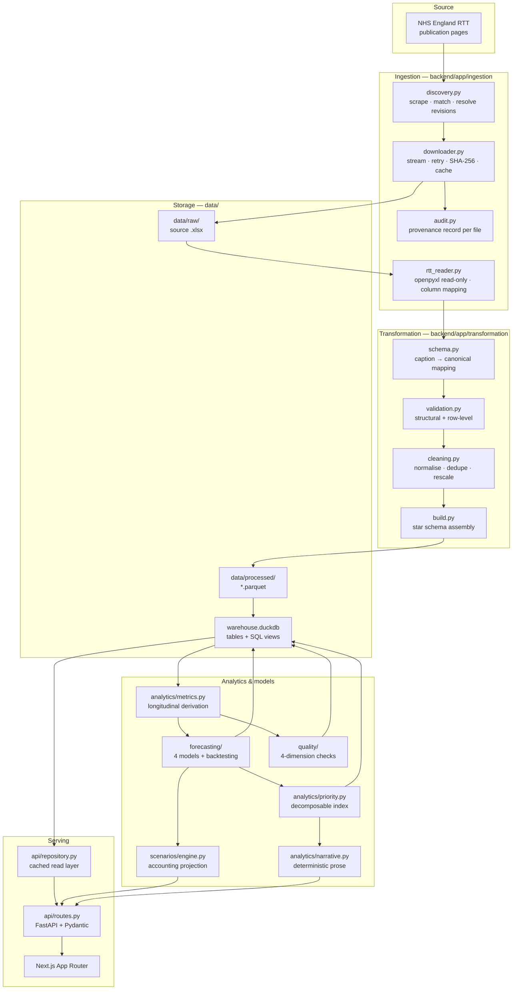
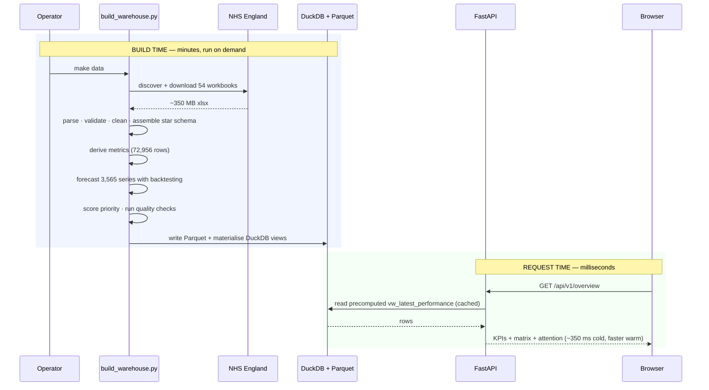
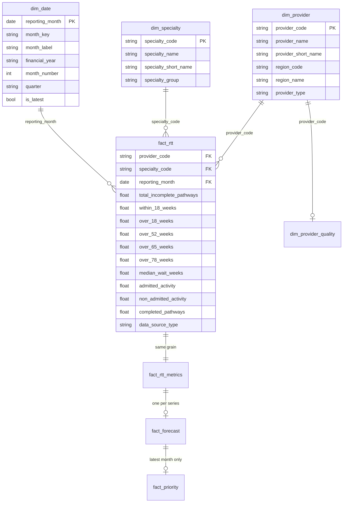
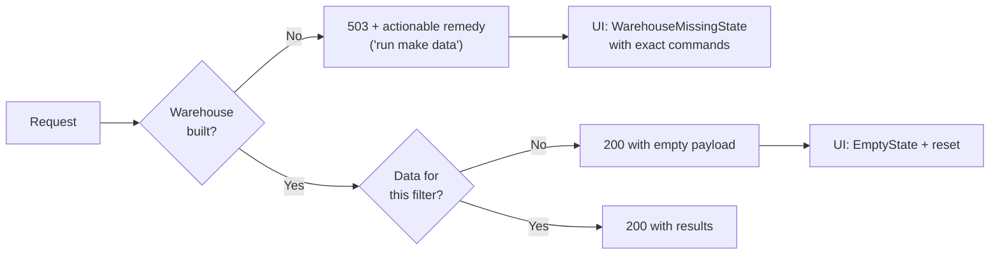

# Architecture

## Design goals

1. **Reproducible on a laptop.** A recruiter should clone, run three commands and see
   the real thing. No database server, no cloud account, no credentials.
2. **Clean layer separation.** Ingestion, transformation, analytics, modelling, API and
   UI are independently testable. No monolithic script.
3. **Fast at read time.** Expensive work happens once at build time; the API reads
   precomputed tables.
4. **Provenance is a feature.** Where a number came from is a first-class output, not
   an afterthought.
5. **Adapt to a moving source.** NHS England renames files and reorganises pages. The
   pipeline must degrade to a clear error, never to a silently wrong number.

---

## System overview



---

## Build-time vs request-time

This split is the main performance decision in the system.



Forecasting 3,565 series takes ~2.5 minutes. Doing that per request would be
indefensible; doing it once at build time makes the dashboard feel instant.

---

## Data model



**Grain:** `fact_rtt` is one row per provider × treatment function × reporting month.
This is asserted by `validate_canonical_fact` and covered by test — a duplicate at this
grain is a hard failure, because every rolling window and growth rate downstream
assumes it.

### Why the waiting list defines the grain

The incomplete-pathways file is the primary fact; admitted and non-admitted activity
are **left-joined** onto it. A month with no published activity file therefore yields
null activity rather than silently dropping waiting-list rows.

### Aggregate exclusion

`C_999` ("Total") is excluded to prevent double counting. This was verified against a
published month rather than assumed: for provider R1H in December 2025, `C_999` =
132,390, exactly the sum of all other treatment functions.

The `X02`–`X06` "Other – …" codes are **retained**. They are genuine, non-overlapping
specialty groupings and account for roughly a third of the national list — dropping
them would have understated the national position by ~33%.

---

## Warehouse tables and views

| Object | Type | Purpose |
|---|---|---|
| `dim_provider`, `dim_specialty`, `dim_date` | table | Conformed dimensions |
| `fact_rtt` | table | Canonical facts, 72,956 rows |
| `fact_rtt_metrics` | table | Facts + ~30 derived longitudinal metrics |
| `fact_forecast` | table | One row per series: model, horizons, intervals, backtest |
| `fact_priority` | table | Latest month, scored and decomposed |
| `fact_quality_issues` | table | Issue register |
| `dim_provider_quality` | table | Per-provider quality roll-up |
| `ingestion_audit` | table | Provenance per source file |
| `warehouse_metadata` | table | Single-row build manifest |
| `vw_provider_specialty_trends` | view | Full monthly panel with labels |
| `vw_latest_performance` | view | Latest month + scores + forecasts (workhorse) |
| `vw_priority_scores` | view | Rankable services with `overall_rank` |
| `vw_provider_summary` | view | Provider roll-up |
| `vw_specialty_summary` | view | Specialty roll-up |
| `vw_national_trend` | view | National monthly position |
| `vw_data_quality` | view | Issues joined to labels |

Aggregation happens in **SQL**, not in frontend JavaScript. One detail worth noting:
`vw_provider_summary` computes a provider's 18-week position as
`SUM(within_18) / SUM(total)`, **not** `AVG(pct_within_18)`. Averaging per-specialty
percentages would weight a 40-pathway service the same as a 12,000-pathway one.

---

## Technology choices

### Why DuckDB + Parquet

| Consideration | Outcome |
|---|---|
| Setup cost | Zero. No server, no credentials, no container required to develop. |
| Analytical SQL | Full window functions, CTEs, `MEDIAN`, `ANY_VALUE`. |
| Performance | 62k rows with joins and window functions returns in milliseconds. |
| Portability | The warehouse is a single file; Parquet is the durable artefact. |
| Reproducibility | `make data` reproduces the entire warehouse from source. |
| Demonstrates | Columnar storage, analytical engines, dimensional modelling. |

PostgreSQL would add a server, credentials and a container dependency to the developer
loop while providing nothing this workload needs. The storage layer is isolated behind
`app/database/warehouse.py` and `app/api/repository.py`, so swapping engines means
changing those two modules — not the API or the analytics.

### Why not Spark / Kafka / Kubernetes

The dataset is 72,956 rows. Distributed processing, streaming and orchestration would
be infrastructure theatre — complexity that adds no analytical credibility and obscures
the reasoning the project is meant to demonstrate.

### Why interpretable forecasting

Each series has 12–24 monthly observations. A neural or gradient-boosted forecaster
would overfit and, more importantly, could not be challenged in an operational meeting.
Four interpretable models competing on out-of-sample error is both more honest and more
useful. The finding that the naive-drift candidate is selected 43% of the time is only *legible*
because the models are simple.

---

## Backend / frontend boundary

The frontend is a **presentation layer**. It does not compute analytics.

| Responsibility | Where |
|---|---|
| Aggregation, filtering, ranking, pagination | Backend (SQL / pandas) |
| Scoring, forecasting, scenarios, narrative | Backend |
| Provenance assembly | Backend |
| Chart rendering, interaction, layout, accessibility | Frontend |
| Number and date formatting | Frontend (`lib/format.ts`) |

The API returns decision-ready rows. The priority matrix is capped server-side at 400
points and the ranked table is paginated, so the browser is never handed 3,450 rows.

`types/api.ts` mirrors the Pydantic models, so a backend schema change surfaces as a
TypeScript error rather than a runtime `undefined`.

---

## Error handling and degradation



A missing warehouse is a **setup state with a specific remedy**, not a crash — so it
gets its own error type end to end (`ApiError.isWarehouseMissing`) and its own UI
component that prints the exact commands to run.

Per-file ingestion failures are **isolated**: one unreadable month is recorded in the
audit log with its error and skipped, rather than aborting an otherwise successful run.

---

## Caching

| Layer | Strategy | Rationale |
|---|---|---|
| Reference data, snapshot, metadata | `functools.lru_cache`, process lifetime | Warehouse is immutable between builds |
| Quality report | `lru_cache`, warmed at startup | ~4 s over 73k rows; unacceptable per request |
| Service/provider history | Bounded dict (800 entries) | Browsing working set is small; bounded so a crawler cannot grow it without limit |
| Frontend | `cache: "no-store"` | Analytics must reflect the current build |

There is no cache-invalidation problem: a rebuild restarts the process.

---

## Security

No authentication is in scope (no PII, no mutations), but the boundary is still
defended:

- **Filter values never reach SQL as text.** Filters are applied to in-memory frames;
  the two parameterised queries use DuckDB bind parameters.
- **Sort columns are allow-listed** (`SORTABLE_COLUMNS`); anything else returns 422.
  Covered by a test that submits `"; DROP TABLE fact_rtt"`.
- **Pydantic models use `extra="forbid"`**, so unknown request fields are rejected.
- **Numeric inputs are bounded** (`uplift_pct` 0–100, `limit` ≤ 500).
- **No filesystem paths are accepted** from requests.
- **CORS is an explicit allow-list**, not `*`.
- **Containers run as non-root** with pinned dependencies.
- **`.env` is git-ignored**; only `.env.example` is committed. No secret is required to
  run the product.

---

## Repository layout

```
nhs-elective-flow-intelligence/
├── config/sources.yaml          # every source URL and pattern (no hardcoded URLs)
├── backend/
│   ├── app/
│   │   ├── config.py            # settings singleton
│   │   ├── main.py              # FastAPI app, lifespan, error handlers
│   │   ├── api/                 # routes, repository, filters, kpis, methodology
│   │   ├── ingestion/           # discovery, downloader, reader, audit, pipeline
│   │   ├── transformation/      # schema, validation, cleaning, build
│   │   ├── analytics/           # metrics, priority, benchmarks, narrative
│   │   ├── forecasting/         # models, engine, validation
│   │   ├── scenarios/           # engine
│   │   ├── quality/             # checks, score
│   │   ├── database/            # warehouse, builder
│   │   ├── models/              # Pydantic schemas
│   │   ├── sql/views.sql        # analytical views
│   │   └── utils/               # logging, mathx
│   └── tests/                   # 188 tests
├── frontend/
│   ├── app/                     # App Router pages
│   ├── components/              # UI + charts
│   ├── lib/                     # api client, formatting, data hooks
│   └── types/api.ts             # mirrors the Pydantic models
├── scripts/                     # download · build · validate · seed_demo
└── docs/
```
