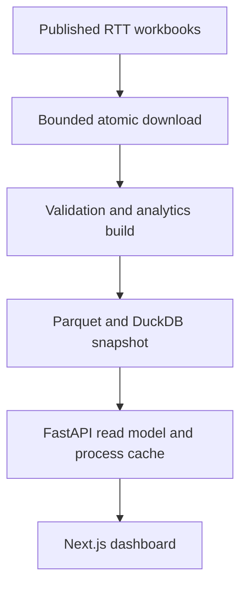

# Maintenance and scaling review

Reviewed 11 November 2026 against the existing local application. This is an
independent aggregate-data prototype. No load capacity or live deployment was
verified by this maintenance change. Historical timings elsewhere are observations
from earlier revisions, not current service objectives.

## Current processing boundary



| Responsibility | Source | Maintenance constraint |
|---|---|---|
| Discover and retrieve | `backend/app/ingestion/` | Stream at most `ingestion.max_download_bytes` per download, retry within the configured count, use unique temporary siblings, delete failed partials and replace the cache only after a nonempty completed response. SHA-256 identifies bytes; it does not validate workbook semantics. |
| Data contract | `backend/app/transformation/`, `backend/app/quality/` | Preserve provider/specialty/month grain and quality gates before publishing a new snapshot. |
| Expensive work | `backend/app/forecasting/`, `scripts/build_warehouse.py` | Forecast during an explicit batch build, not on every HTTP request. |
| Read path | `backend/app/api/repository.py` | Cached data is process-local. All workers must use the same immutable snapshot and restart or clear caches when it changes. |
| User interface | `frontend/lib/api.ts` and `frontend/lib/useApiData.ts` | Preserve unavailable-data states and typed response contracts; do not silently substitute synthetic data for official data. |

## Defect addressed

The downloader previously reused one `.part` filename, left interrupted partials,
accepted empty successful responses and streamed without a byte ceiling. Concurrent
attempts could interfere, and a forced empty download could replace valid cached
data. Each attempt now owns a unique partial, rejects empty/oversize data, records
its own checksum before replacement, and cleans up on both success and failure.
Dataset and file names must be single path components.

This is an atomic file operation, not a distributed transaction. Cache hits still
reuse existing nonempty files; use `force=True` for a deliberate source refresh.
Ingestion should have one scheduled writer per snapshot. The maximum response
size defaults to 128 MiB; streamed bytes are checked rather than trusting headers.

## Scale gates

1. Measure representative API concurrency, cold/warm latency, RSS, warehouse size,
   build duration and source-download failures before setting capacity targets.
2. Build a candidate snapshot separately; validate it, then promote a versioned
   immutable artifact. Keep the previous artifact for rollback. Do not rebuild a
   DuckDB file under serving processes.
3. Add read replicas only after every replica pins the same snapshot identity and
   cache lifecycle. More replicas do not improve a serial ingestion job.
4. If the full fact-table cache or batch duration exceeds the deployment budget,
   profile queries and partition build inputs before introducing another database
   or distributed compute service.

These are operating requirements and future gates, not implemented cloud services.
The earlier AWS/Power BI proposal remains a separate open pull request and was not
silently merged by this maintenance change.

## Verification and recovery

Run the existing backend suite and the new offline downloader regressions:

```bash
cd backend
python -m pytest
ruff check .
```

The existing CI also builds a synthetic warehouse, validates it, reruns API tests,
and builds the frontend and Docker images. For a failed source download, inspect
the audit result, retry explicitly, and retain the last validated snapshot. A
successful HTTP response is not evidence of a valid warehouse or a healthy UI.
