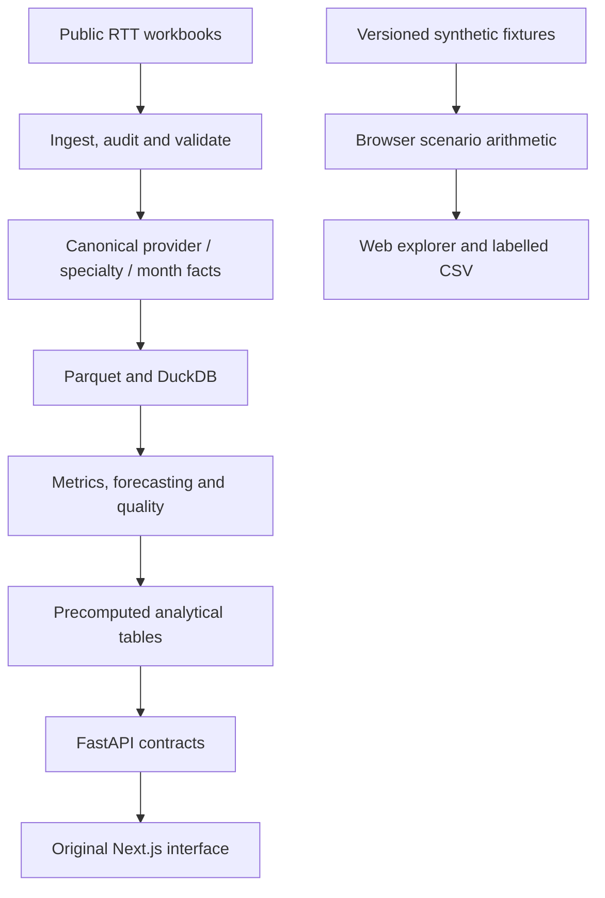

# Web edition and engineering review

Revision: 14 November 2026. This document records implemented changes and their
verification boundaries. It does not certify a production NHS service.

## Experience and source boundaries

The latest web presentation lives in `web/` and is packaged separately for
ChatGPT Sites. It provides a working activity scenario explorer, a labelled
trajectory chart, exact output table, CSV export and an unavailable-data example.
The controls are keyboard accessible, inputs have visible labels, the chart has
an accessible description, and reduced-motion preferences are respected.

The rising and improving fixtures reproduce the values in
`backend/tests/test_scenarios.py`. The capacity-constrained fixture is an
additional synthetic example. All exports carry `DEMO_SYNTHETIC`; fictional
provider labels do not imply observations from a real organisation.

The web edition uses precomputed fixture forecasts. It does not download official
workbooks, fit the Python forecasting models, query the warehouse or call the
original API. Original data ingestion, dimensional schema, FastAPI endpoints and
Next.js source are preserved. The original configured Vercel/Render deployment
has not been verified as a working end-to-end service during this review.

## Reliability change: recent activity is a calendar window

Previously `_recent_activity` removed missing activity values, then selected the
last three observations. If all recent months were missing, a much older set
could be presented as recent capacity. This could generate a plausible-looking
scenario from stale evidence.

The engine now derives the last three calendar months ending at the latest
reporting month, then requires exactly one finite, non-negative activity value
for each month. Missing dates, gaps, duplicate recent months, missing values and
invalid activity return `no_activity_data`. A zero mean remains unavailable.
Non-finite uplift raises `ValueError` at the domain boundary; finite out-of-range
values retain the existing 0–100% clamp.

Trade-off: a service with an incomplete window now produces fewer scenarios.
That is intentional: the output communicates missing evidence instead of
substituting an unannounced historical basis. No database or public response
schema changes were required.

## System architecture

The browser explorer is an independent delivery path. Its outputs are not routed
through the original warehouse and must not be represented as official statistics.

## Architecture decisions

| Decision | Reason | Consequence |
|---|---|---|
| Preserve the existing star schema | Provider × specialty × month remains the canonical grain | No data migration or rewriting of original work |
| Keep original analytics at build time | Forecasting every service on every API request is unnecessary | Freshness depends on the reviewed ingestion and rebuild process |
| Require complete recent activity | Missing capacity evidence must not silently become stale evidence | Explicit unavailable results are more common |
| Host this edition as static assets | Scenario arithmetic needs no server, secrets or external dependencies | The website cannot run the full Python analytical pipeline |
| Use exact tables beside charts | Readers can inspect arithmetic and access values without interpreting a graphic | More content, but stronger transparency and accessibility |
| Label every exported row synthetic | Exported data can travel outside the site's visual context | CSV consumers retain its provenance |

## Deployment architecture

### ChatGPT Sites web edition

Static assets are built from `web/index.html`, `styles.css`, `scenario.js` and
`app.js`, then packaged as `dist/`. The host's `.openai/hosting.json` references
the assigned Site ID and that static directory. Sites publishes the saved source
version; no API credential or analytics database is required by these assets.

The deployment boundary is browser-local interaction. Refreshing the page resets
the scenario. A CSV download is generated locally; no user input is uploaded.
The release should record the returned deployment URL and version in the README.
Rollback means redeploying the preceding saved Site version.

### Original application target

The existing target is a Vercel-hosted Next.js frontend and Render-hosted FastAPI
service. The API materialises DuckDB from versioned Parquet during its build.
Promote refreshed data only after validation and provenance review, and deploy the
backend and frontend against compatible API schemas. A new release needs health,
metadata and representative analytical-route checks before claiming availability.

The static Sites deployment does not establish that the original backend is live.

## Professional engineering principles applied

- **Separation of concerns:** mathematical scenario logic is separate from DOM
  rendering in the web edition and remains separate from ingestion in Python.
- **Explicit contracts:** missing or non-finite inputs have defined behaviour.
- **Reproducibility:** stable fixtures and dependency-free Node tests make the
  website's arithmetic reproducible without a live dataset.
- **Evidence-led claims:** synthetic scenarios, historical reference figures and
  live service availability have distinct labels.
- **Progressive accessibility:** keyboard controls, meaningful labels, chart
  description, table equivalent and reduced-motion support.
- **Operational honesty:** stabilisation within the arithmetic model's limit is
  not evidence that the additional capacity is achievable.

## Verification

Completed locally on 14 November 2026:

- `node --test web/tests/scenario.test.cjs`: six tests passed. These exercise
  fixture parity, zero-uplift identity, monotonicity over every integer uplift
  from 0 to 100, non-negative backlog, missing activity, finite-input checks and
  improving/constrained interpretation.
- `node --check web/app.js` and `node --check web/scenario.js`: passed.
- `python -m compileall -q backend/app/scenarios backend/tests/test_scenarios.py`:
  passed syntax compilation.

Backend regression tests were added to `backend/tests/test_scenarios.py`. The
default local Python environment lacks pandas, NumPy and pytest; the backend
tests have not been executed in that environment. Run the normal backend suite
with the project's dependencies before treating the Python change as fully
validated. No full-stack availability, performance or clinical-validity claim
is made by these checks.

## Further verification before operational use

Review the published data licence and attribution for any redistributed official
snapshot. Re-run ingestion/quality checks against its recorded vintage, exercise
API contract tests, and inspect provider re-codes and data revisions. Assess
forecast calibration and operational constraints with domain experts before using
scenarios to inform resource decisions.
